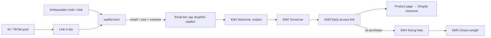

# Email Signup Funnel

## Built
- Waitlist page (`storefront/waitlist.html`) plus signup forms on the homepage. They collect email, optional size, and an explicit consent checkbox, and validate in the browser.
- Forms POST JSON to `TFM_CONFIG.waitlistEndpoint`. **Currently empty = preview mode: nothing is sent or stored.**

## To connect (pick one)
1. **Shopify (recommended once the store exists):** use Shopify's customer newsletter form, or a Shopify Forms app, so subscribers land in Shopify Email.
2. **Klaviyo:** create a list, then point the endpoint at a small serverless function that calls Klaviyo's Subscribe Profiles API. The private key stays server-side, never in the browser.
3. **Formspree/Basin:** quickest. Paste the form URL into `waitlistEndpoint`.

## Track
| Metric | Target |
|---|---|
| Profile → link click | 3–5% |
| Waitlist page → signup | 25%+ |
| Waitlist → preorder | 15–25% (100–170 signups for 25 preorders) |

Use UTM links per channel: `?utm_source=instagram&utm_medium=bio&utm_campaign=drop001`.
